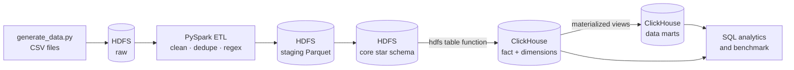
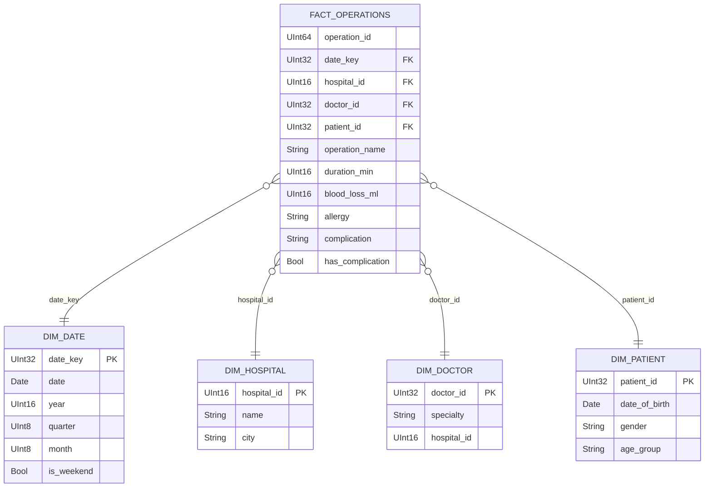

# Hospital Data Warehouse with PySpark and ClickHouse

A data-warehouse pipeline for a network of hospitals. It scales up my [Hospital Management Database](https://github.com/LakoshaAhmed/Hospital-) project from 620 rows in PostgreSQL to **5 million operations**. The raw files are stored in **HDFS**, processed with **PySpark**, and analyzed in **ClickHouse**.

## What it does

- **Generates** 5M+ synthetic operations, 1M patients and 2,000 doctors, with realistic problems: duplicate rows, extra spaces, mixed letter case, missing values and free-text doctor notes.
- **Stores** the raw CSV files in HDFS.
- **Cleans and transforms** the data with PySpark: types, de-duplication, name normalization, and **regular expressions** that pull structured fields out of the notes (duration, blood loss, allergy, complication).
- **Models** the data as a **star schema** across 3 layers: raw → staging → core.
- **Loads** the core layer into **ClickHouse**, using partitions, a sort key and LowCardinality columns.
- **Builds data marts** with materialized views (SummingMergeTree and AggregatingMergeTree).
- **Benchmarks** the optimized design against a naive table.

## Architecture



| Layer | Where | Contents |
| --- | --- | --- |
| raw | HDFS, CSV | Files exactly as the source system sent them |
| staging | HDFS, Parquet | Cleaned, typed and de-duplicated tables |
| core | HDFS, Parquet → ClickHouse | Star schema: `fact_operations` + 4 dimensions |
| marts | ClickHouse | Pre-aggregated tables for reports |

## Star schema



## Regular expressions in the ETL

The doctors' notes are free text. PySpark's `regexp_extract` turns them into columns:

| Note example | Pattern | Extracted |
| --- | --- | --- |
| `Duration 190 min. Estimated blood loss: 616 ml.` | `(?i)(?:duration:?\|op time)\s*(\d+)\s*min` | `duration_min = 190` |
| same | `(?i)blood loss:?\s*(\d+)\s*ml` | `blood_loss_ml = 616` |
| `Allergic to latex - alternative drugs administered.` | `(?i)allergic to ([a-z]+)` | `allergy = latex` |
| `Complication: blood clot. Blood loss 300ml...` | `(?i)complication:\s*([a-z ]+?)\.` | `complication = blood clot` |

## ClickHouse optimization

- **`PARTITION BY toYYYYMM(operation_date)`:** a query for one month opens only that month's partition.
- **`ORDER BY (hospital_id, operation_date, doctor_id)`:** the sparse primary index skips blocks of rows when filtering by hospital and date. Check it with `EXPLAIN indexes = 1` (see `sql/03_queries.sql`).
- **`LowCardinality(String)`:** repeated text such as operation names and specialties is stored as a dictionary, which uses less disk and makes grouping faster.
- **Materialized views → data marts:** reports read a few thousand pre-aggregated rows instead of 5M raw ones.

### Benchmark results

Run `python scripts/benchmark.py` and paste the generated `benchmark_results.md` here.

| Query | Naive: time | Naive: rows read | Optimized: time | Optimized: rows read | Speed-up |
| --- | ---: | ---: | ---: | ---: | ---: |
| Count one hospital's operations in one month | … | … | … | … | … |
| Daily operations per hospital in 2025 | … | … | … | … | … |
| Complication rate per operation type | … | … | … | … | … |

## How to run

You need Docker (with about 6 GB of RAM for Docker) and Python 3.10+.

```bash
git clone https://github.com/LakoshaAhmed/hospital-dwh.git
cd hospital-dwh
mkdir -p data                 # create it yourself so the containers can write to it
docker compose up -d          # HDFS, Spark, ClickHouse

# Whole pipeline in one command (5M operations, about 5–10 minutes)
bash scripts/run_pipeline.sh

# Or a quick test with 200k operations
bash scripts/run_pipeline.sh 200000

# Benchmark
pip install clickhouse-connect
python scripts/benchmark.py
```

Step by step, the pipeline runs:

| Step | Command |
| --- | --- |
| 1. Generate data | `docker exec spark python src/generate_data.py --operations 5000000 --out data/raw` |
| 2. Upload to HDFS | `bash scripts/upload_to_hdfs.sh` |
| 3. PySpark ETL | `docker exec spark spark-submit --driver-memory 4g src/spark_etl.py --base hdfs://namenode:9000/hospital` |
| 4. Load into ClickHouse | `bash scripts/load_to_clickhouse.sh` |

Useful UIs: HDFS at http://localhost:9870 and Spark at http://localhost:4040 (while a job runs).

Run the analytical queries:

```bash
docker exec -it clickhouse clickhouse-client --password clickhouse
```

then paste any query from `sql/03_queries.sql`.

### Without Docker or HDFS

The ETL also works on local files:

```bash
pip install -r requirements.txt
python src/generate_data.py --operations 200000 --out data/raw
spark-submit src/spark_etl.py --base data
```

## Project structure

```
hospital-dwh/
├── docker-compose.yml        # HDFS, Spark and ClickHouse containers
├── hadoop.env                # HDFS settings
├── requirements.txt
├── src/
│   ├── generate_data.py      # synthetic raw data with realistic problems
│   └── spark_etl.py          # PySpark: raw -> staging -> core star schema
├── sql/
│   ├── 01_create_tables.sql  # ClickHouse star schema (MergeTree, partitions, sort keys)
│   ├── 02_data_marts.sql     # materialized views and marts
│   └── 03_queries.sql        # analytical queries and EXPLAIN checks
└── scripts/
    ├── run_pipeline.sh       # whole pipeline in one command
    ├── upload_to_hdfs.sh
    ├── load_to_clickhouse.sh # loads Parquet from HDFS with hdfs() table function
    └── benchmark.py          # naive vs optimized query timings
```

## Tech stack

Python · pandas · NumPy · PySpark · HDFS · ClickHouse · SQL · Docker

## Author

**Ahmed Lakosha** · Applied Mathematics and Computer Science, MIPT
[ahmedlakosha72@gmail.com](mailto:ahmedlakosha72@gmail.com) · [github.com/LakoshaAhmed](https://github.com/LakoshaAhmed)
